# 

  

  

---

  

## 🧪 Currently Exploring

| Area | Focus |
|:---|:---|
| 🎨 Design | Visual communication & UI/UX |
| 🌐 Frontend | Responsive web development |
| 🤖 Automation | n8n, APIs & AI workflows |
| 🎬 Multimedia | Digital content & storytelling |

---
<!--  
## 📊 GitHub Stats

---
-->
## 🚀 My Projects

🔹 **Digital Design** — Visual concepts and creative assets  
🔹 **Web Development** — Websites and responsive interfaces  
🔹 **AI & Automation** — Intelligent workflows and integrations  
🔹 **Multimedia** — Creative projects combining design and technology  

*More projects coming soon as I turn my learning into practical solutions.*

---

  

  <i>"Go Big or Go Home."</i>

